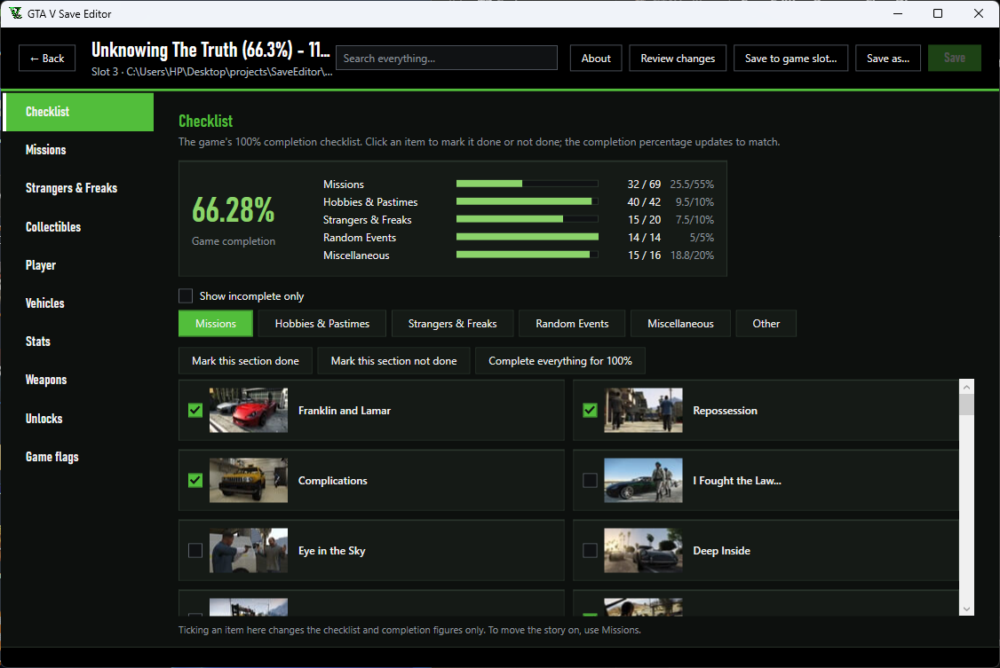

# GTA V Save Editor

A free save editor for **Grand Theft Auto V story mode on PC**. Open a save, change it through plain pages, and save.

[](https://github.com/nikankad/GtaVEditor/actions/workflows/ci.yml)



## Download

1. Install the **[.NET 10 Desktop Runtime for Windows x64](https://dotnet.microsoft.com/en-us/download/dotnet/10.0)**.
   Choose **Desktop Runtime**, rather than the SDK or ASP.NET Core Runtime. You only need to install it once.
2. Download **GtaVSaveEditor-win-x64.zip** from the [latest release](https://github.com/nikankad/GtaVEditor/releases/latest).
3. Extract the ZIP and run **GtaVSaveEditor.exe**. Keep the included license and notices with it.

The app targets Windows 10/11, 64-bit. The runtime is installed separately to keep downloads small.
Release downloads include `SHA256SUMS.txt`; check the ZIP with `Get-FileHash -Algorithm SHA256` if you want to verify it.

Some releases include the PC save encryption key. If the start page asks for a key, choose **Import key…**, select a
32-byte key file, then select one of your own saves to verify it. See [local key setup](tools/KeyRecovery/README.md)
for the supported recovery tool. Source builds use this same import flow.

## Supported saves

This editor handles the PC story-mode save layout described in [the format research](docs/FINDINGS.md).
**GTA Online and console saves are unsupported. GTA V Enhanced compatibility has not been verified.**
Completing a mission entry changes saved completion data; it does not play the mission or simulate all of its
rewards, cutscenes, and story transitions. Keep a separate copy before changing story progress.

## What it can do

- **Checklist:** tick off 100% completion items
- **Missions:** complete story missions, pick heist approaches, unlock and revive heist crew
- **Strangers & Freaks:** complete their missions
- **Collectibles:** mark letter scraps, spaceship parts, bridges and more as found, on a map you can zoom, drag and click
  for each item's number and location
- **Player:** money, skills, health, armor, wanted level, game clock, and where each character is, picked on a map
- **Vehicles:** park cars, planes, helicopters and boats in your garages, hangars and docks; own businesses
- **Weapons and Unlocks:** give weapons and ammo, unlock Ammu-Nation stock, clothes, Director Mode actors, Flight School medals
- **Stats and Game flags:** every stat and story switch, with plain-English names
- **Search everything:** type in the box at the top to find any mission, collectible, flag or stat, tick it right there or jump to its tab
- **Check before saving:** every save first lists what you changed, with an Undo for each one

## Back up your saves

Editing a save can corrupt it or break story progress. The editor copies each save to a backups folder before
writing it, but keep your own copy of any save you care about. Use at your own risk.

Close GTA V before editing. Automatic backups are in `%LocalAppData%\SaveEditor\Backups\gtav-pc`;
use **Open backups folder** on the start page. To restore one, close the game, copy the backup to your profile
folder under its original `SGTA500xx` filename, and check cloud-save synchronization before starting the game.
Imported keys are stored locally at `%AppData%\SaveEditor\keys\gtav-pc.key`.

Saves are in `Documents\Rockstar Games\GTA V\Profiles\<id>\SGTA500xx`. If cloud saves are on, the game may replace
an edited save with the cloud copy.

## Build it yourself

Needs Windows and the [.NET 10 SDK](https://dotnet.microsoft.com/en-us/download/dotnet/10.0).
The SDK includes the runtime needed for development. Install the SDK version listed in `global.json`;
CI and release builds use that exact version so dependency locks remain reproducible.

```bash
git clone https://github.com/nikankad/GtaVEditor.git
cd GtaVEditor
dotnet restore SaveEditor.sln --locked-mode
dotnet run --project src/SaveEditor.App
```

Builds from source don't include the save encryption key, so the app asks you to import a 32-byte key file once.

```bash
dotnet test tests/SaveEditor.Tests
```

Build the small Windows release ZIP from PowerShell:

```powershell
./scripts/Publish-App.ps1 -Version 1.1.0 -LockedMode
```

Output: `artifacts/release/GtaVSaveEditor-win-x64.zip` and `SHA256SUMS.txt`.
See [contributing](CONTRIBUTING.md) for development and testing, and [releasing](docs/RELEASE.md) for the maintainer checklist.

## Help and issues

[Report a bug](https://github.com/nikankad/GtaVEditor/issues/new/choose) with the app version, Windows version,
game edition, and steps to reproduce it. Do not post saves, encryption keys, or personal profile paths.
Use the [security policy](SECURITY.md) for security reports.

## License and credits

Original code is licensed under [Apache-2.0](LICENSE). Third-party artwork, map geometry, and game trademarks
retain their separate rights; see [NOTICE](NOTICE) and [third-party notices](THIRD_PARTY_NOTICES.md).

This project is not affiliated with Rockstar Games or Take-Two Interactive.
